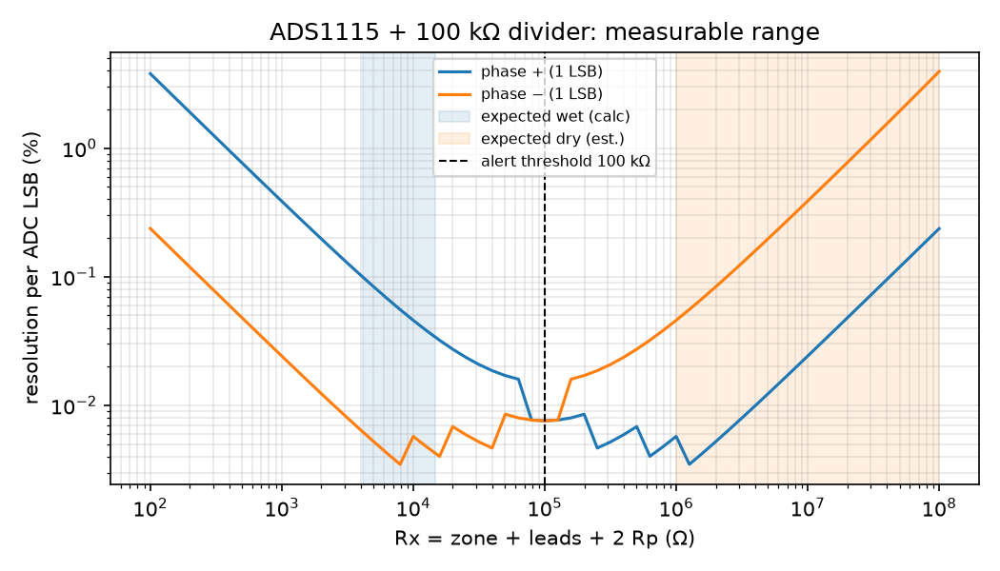

# Readout calculations (generated by calc_readout.py, 2026-10-14)

Labels: [PUB] published · [DS] datasheet (verify) · [EST] estimate · [DES] design choice. **No measured data yet.**

| Quantity | Value | Basis |
|---|---|---|
| Solution A bulk conductivity | 1.49 S/m | [EST] from molar conductivity of NaCl at 0.142 M + CaCl2 |
| Wet zone resistance (gap 1.0 mm, length 6 mm) | 167–2778 Ω | [EST] R = g/(κ_eff·L·t), κ_eff 0.3–1.0 S/m, t 0.2–1.0 mm |
| LIG lead resistance (100 squares) | 2.0–10.0 kΩ | Rs 20–100 Ω/sq [PUB/EST] |
| Total wet reading Rx | 4.2–14.8 kΩ | sum incl. 2 × 1 kΩ protection |
| Dry reading (lowest expected) | ≥ 1 MΩ | [EST], **must be measured** on the real dressing (E3 baseline) |
| Geometric-mean threshold | 122 kΩ → use 100 kΩ alert, 300 kΩ release (hysteresis) | [DES] |
| Margin wet → threshold / threshold → dry | 6.8× / 10× | [EST] |
| Resolution at 1 kΩ / 100 kΩ / 10 MΩ (best phase) | 0.024 % / 0.008 % / 0.02 % per LSB | [DS] ADS1115 auto-ranged |
| Systematic error budget (Rref, gain, ADC loading) | ±1.7 % | [DS]/[DES]; ADC loading 1.7 % is calibrated out with the on-board 100 kΩ check resistor |
| Max excitation current | 32 µA | [DES] Vdd / (Rref + Rx_min); bench only |
| Charge per 5 ms phase | 0.16 µC | [DES] |
| Double-layer voltage swing per phase | 0.66 mV (×100 margin → 0.07 V) | [PUB] C ≈ 4 mF/cm² (Lin 2014, acid electrolyte) on 0.06 cm² |

## Conclusions

1. **Wet vs dry is easy to tell apart.** Expected wet readings (4.2–15 kΩ) and dry readings (≥ 1 MΩ) differ by more than 10×. A 100 kΩ threshold leaves margin on both sides **if** the real dry baseline is ≥ 1 MΩ.
2. **The ADS1115 is more than adequate.** Resolution is better than 0.1 % per LSB from 1 kΩ to 1 MΩ. The ESP32-C3's internal ADC would also do for a binary threshold; the ADS1115 is chosen for logged, quantitative data (E3).
3. **No electrolysis expected.** Bipolar pulses move the LIG double layer by about 0.7 mV. Even with 100× less capacitance than the published value, that stays below the 1.23 V needed to split water.
4. **Leads matter when wet.** Lead resistance (up to about 10 kΩ) is comparable to the wet zone itself. Treat the measurement as *wet/dry per zone* plus a trend, not as an absolute conductivity.

