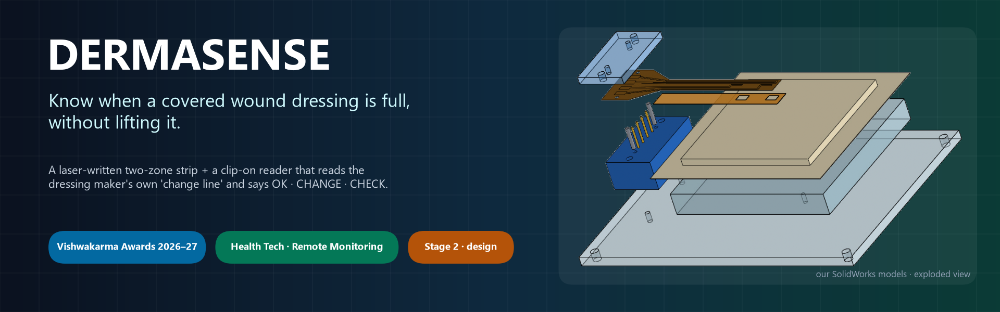
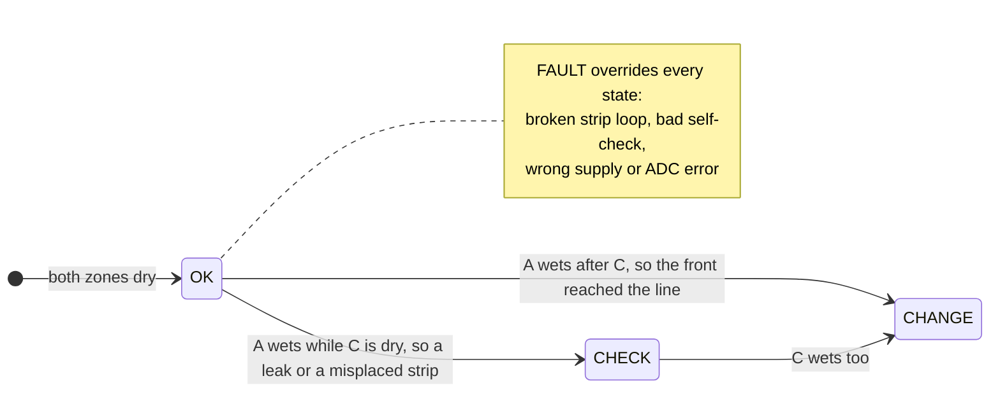
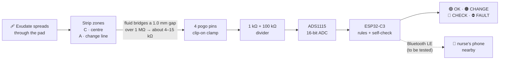
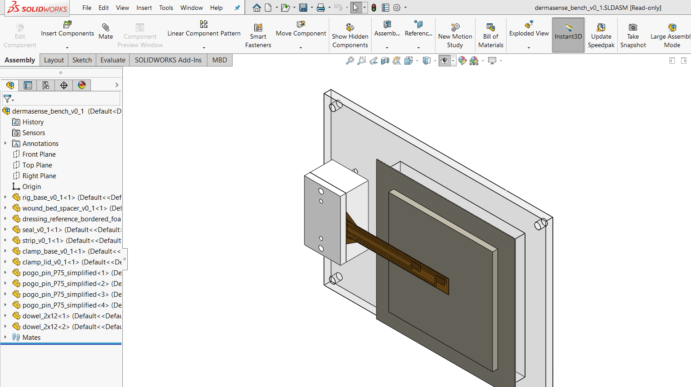
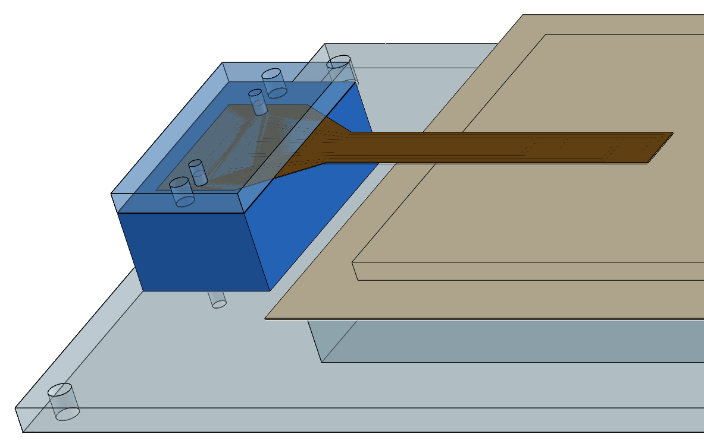
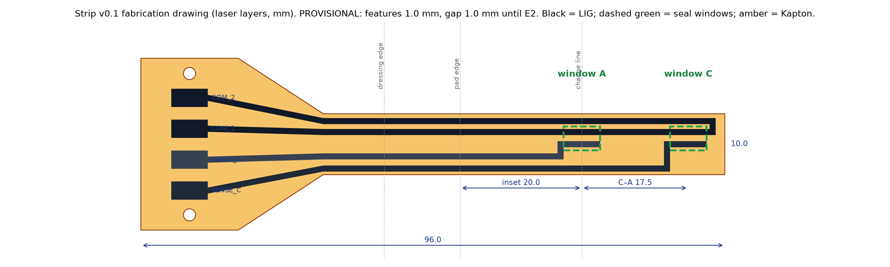
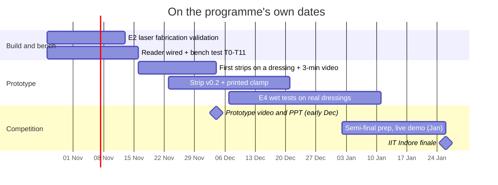

<p align="center">
  
</p>

<p align="center">
  
  
  
  
  
  
  
  
</p>

<p align="center">
  <b><a href="FINAL_SUBMISSION/Dermasense_VK26-IITI-HT-0050_Stage2.pdf">📑 Stage 2 deck (PDF)</a></b> ·
  <a href="#-the-problem">Problem</a> ·
  <a href="#-how-it-works">How it works</a> ·
  <a href="#-what-we-have-built">What we built</a> ·
  <a href="#-verified-so-far">Verified</a> ·
  <a href="#-roadmap">Roadmap</a> ·
  <a href="#-team">Team</a>
</p>

---

> [!IMPORTANT]
> **Design stage (20 Oct 2026).**
> - The strip, the clamp, the reader circuit and the firmware are **designed and checked in software and CAD**.
> - **Nothing has been built or tested physically yet.**
> - We do not claim that the sensor works, that the layer is graphene, or any clinical benefit.

## 🩹 The problem

> **Nurses and family carers cannot see when a covered wound dressing has actually become full, so they change it by guesswork: too early, which hurts the patient and wastes dressings, or too late, which lets fluid leak onto the skin.**

<table>
<tr>
<td align="center" width="25%"><h2>1.9–4.5</h2>per 1,000 people in Indian community surveys live with a <b>chronic wound</b><br><sub>Gupta 2004 · Sharma 2024</sub></td>
<td align="center" width="25%"><h2>101 M</h2>Indians live with <b>diabetes</b>; 19–34 % may get a foot ulcer in their lifetime<br><sub>ICMR-INDIAB 2023 · Armstrong 2017 (estimate)</sub></td>
<td align="center" width="25%"><h2>44.9 %</h2>of 588 dressing changes came while moisture was <b>still optimal</b><br><sub>Milne 2016</sub></td>
<td align="center" width="25%"><h2>40.3 %</h2>of 2,018 patients say <b>dressing-change pain</b> is the worst part<br><sub>Price 2008</sub></td>
</tr>
</table>

**Why it happens:**
- Dressing makers already define a *change-now* point: exudate about **2 cm** from the pad edge, or **"at 75 %"** on a visual indicator.
- That sign is **visual**, but the dressing is hidden under a bandage, a sock or clothing.
- So the carer can only follow the clock, peek, or wait for a leak.
- Each visit takes about **18 min** (a UK patient survey), and each early change throws away a **₹242–514** dressing.

## 💡 The idea

**Read the dressing maker's own change line electrically, from outside, without lifting anything.**

- A thin **laser-written carbon strip** sits on the *outer* face of the dressing pad, so it never touches the wound.
- It has two zones:
  - **C** at the pad centre
  - **A** exactly on the maker's change line
- A small **clip-on reader** checks both zones.



| State | LED | What the carer does |
|---|---|---|
| 🟢 **OK** | green | Nothing: the dressing still has capacity |
| 🟠 **CHANGE** | amber | Change the dressing now |
| 🔴 **CHECK** | red, blinking | Look: the line wet before the centre (leak or misplaced strip) |
| ⛔ **FAULT** | red | The strip or reader has a problem; never shown as OK |

## ⚙️ How it works



- **Bipolar drive:** each zone is driven both ways, so the wet strip sees **no net DC**.
- **Hysteresis and persistence:** "wet" means below **100 kΩ** and "dry" means above **300 kΩ**, and the state must hold for **3 scans in a row**.
- **Self-check:** a known **100 kΩ** resistor is checked on **every scan**.
- **Remote view:** the reader broadcasts its state over **Bluetooth LE**, readable with any scanner app. It is compiled and tested in software; there is no phone app yet.
- **Values:** these are *calculated*, to be measured in experiments E2 and E4.

<details>
<summary><b>See the full sensing picture</b> (dressing layers → dry vs wet gap → reader)</summary>


</details>

## 🛠️ What we have built

<table>
<tr>
<td width="50%"><br><sub><b>SolidWorks bench rig, exploded:</b> lid, strip, seal tape, 4 pogo pins, dowels, clamp base, reference dressing, spacer, rig base</sub></td>
<td width="50%"><br><sub><b>Our assembly open in SolidWorks 2019</b>, with its feature tree (13 components)</sub></td>
</tr>
<tr>
<td><br><sub><b>Reader circuit:</b> one zone's measurement path, drawn from our KiCad netlist, above the real sheet</sub></td>
<td><br><sub><b>Contact clamp:</b> spring pins press on the strip's 3 × 6 mm pads; 2 dowels align it</sub></td>
</tr>
<tr>
<td colspan="2"><br><sub><b>Strip v0.1 laser file:</b> 10 mm wide, 1.0 mm lines and gaps, zone windows C and A, 4 pads at 5.08 mm (provisional until E2)</sub></td>
</tr>
</table>

| | Built so far | Folder |
|---|---|---|
| 🧪 **Sensor strip** | Strip generator, laser files (DXF), seal layer, design-rule check | [`4_sensor_strip`](4_sensor_strip/) |
| 🧩 **Mechanical** | 9 SolidWorks parts, 1 assembly, 7 A3 drawings, 10 STEP files; built and verified by script | [`5_cad`](5_cad/) |
| 🔌 **Electronics** | KiCad 10 reader schematic, netlist, BOM with 3 quoted prices (₹242 / ₹125 / ₹354) | [`6_electronics`](6_electronics/) |
| 💾 **Firmware** | ESP32-C3 reader: measurement, state machine, USB log, Bluetooth LE broadcast | [`7_firmware`](7_firmware/) |
| 🔬 **Experiment E2** | Laser fabrication test: **72 samples and pass rules fixed before any data**, printable bench sheets, analysis script | [`e2_experiment`](4_sensor_strip/e2_experiment/) |
| 🧭 **Decisions and risk** | Requirements, 15 logged decisions, 5 concepts scored on 13 criteria, FMEA with 15 failure modes | [`3_decisions`](3_decisions/) |
| 📚 **Research** | 41 sources with reading depth, research gap, prior-art search, nurse interview guide | [`2_research`](2_research/) |

## ✅ Verified so far

| Check | Result | Honest limit |
|---|---|---|
| CAD verification in SolidWorks | ✅ **99 pass · 0 fail** · ⏳ 5 waiting for E2 data | It caught a real clash (seal tape under the clamp), now fixed |
| Laser files | ✅ **35 / 35** | The files are correct; **nothing is lased yet** |
| KiCad electrical rules check | ✅ **0 violations** | Schematic only |
| Netlist ↔ firmware ↔ strip pads | ✅ **0 mismatches** | Design consistency |
| Firmware build (ESP32-C3) | ✅ **0 warnings**, 49 % of flash | ⏳ **Never run on a board** |
| Firmware tests | ✅ **23** compile-time + **16** PC tests | Software only |

**Still to do:**
- ⏳ Run the laser experiment E2.
- ⏳ Wire the reader and bench-test it, including Bluetooth.
- ⏳ Wet tests on real dressings (E4).
- ⏳ Raman test before ever saying "graphene".
- ⏳ FEA (loads are under 3 N, so hand calculations for now).

## 🗺️ Roadmap



**Gates.** Each step must pass before the next:
1. Sheet-resistance CV ≤ 20 % (E2).
2. Bench test T0–T11 passes.
3. Alert within ±10 % of the visible front (E4).
4. Live demo with logged raw data.

## 👥 Team

**Soham Prabhakar Kadu** · **Bhakti Ajay Kadam**

Sanjivani University · Vishwakarma Awards 2026–27 · Application ID **VK26-IITI-HT-0050** · Health Tech: Emergency Response & Remote Monitoring

<details>
<summary><b>📂 Repository map</b></summary>

| Folder | Contents |
|---|---|
| [`FINAL_SUBMISSION/`](FINAL_SUBMISSION/) | **Submitted Stage 2 deck** (PPTX + PDF) and the submission checklist |
| [`Stage2_Review_Output_2026-10-20/`](Stage2_Review_Output_2026-10-20/) | Build scripts, QA report, change log and evidence map from the template rebuild |
| [`1_presentation/`](1_presentation/) | Deck builder, figure scripts, figures, claim → evidence matrix |
| [`2_research/`](2_research/) | Literature, research matrix, research gap |
| [`3_decisions/`](3_decisions/) | Requirements, decision log, sensor selection, FMEA |
| [`4_sensor_strip/`](4_sensor_strip/) | Strip generator, laser files, E2 experiment |
| [`5_cad/`](5_cad/) | SolidWorks native files, drawings, STEP, build and verification scripts |
| [`6_electronics/`](6_electronics/) | Readout calculations, KiCad schematic, BOM |
| [`7_firmware/`](7_firmware/) | ESP32-C3 firmware, PC tools, wiring, bench test |
| [`docs/`](docs/) | README assets |
| [`PROJECT_AUDIT.md`](PROJECT_AUDIT.md) | What is verified, what is not |
| [`LAB_NOTEBOOK.md`](LAB_NOTEBOOK.md) | Dated work log |

</details>

<details>
<summary><b>🔁 Re-run the checks yourself</b></summary>

```bash
python 4_sensor_strip/verify_laser_files.py
```

```bash
python -m pytest -q 7_firmware/tools
```

```bash
python 7_firmware/tools/check_consistency.py
```

```bash
arduino-cli compile --fqbn esp32:esp32:esp32c3:CDCOnBoot=cdc 7_firmware/reader_v0_1
```

The full CAD verification (`python 5_cad/verify_cad.py`) needs SolidWorks.

</details>

<details>
<summary><b>🧠 How this work was done</b></summary>

- The CAD models, the KiCad schematic, the firmware and most documents are **generated by scripts**, so every model and check can be rebuilt and re-run.
- The scripts were written with **AI assistance**, under the team's direction. The lab notebook records which entries were AI-drafted.
- The **physical build and every test are done by the team**, starting with experiment E2.

</details>

<details>
<summary><b>📖 Key references</b></summary>

1. Milne S.D. et al., *Int. Wound J.* 13(6):1309–1314 (2016). doi:10.1111/iwj.12521
2. Gupta N. et al., *J. Wound Care* 13(8):323–325 (2004). doi:10.12968/jowc.2004.13.8.26657
3. Sharma A. et al., *Cureus* 16(9):e68684 (2024). doi:10.7759/cureus.68684
4. Anjana R.M. et al. (ICMR-INDIAB-17), *Lancet Diabetes Endocrinol.* 11(7):474–489 (2023)
5. Armstrong D.G., Boulton A.J.M., Bus S.A., *N. Engl. J. Med.* 376:2367–2375 (2017). doi:10.1056/NEJMra1615439
6. Price P.E. et al., *Int. Wound J.* 5(2):159–171 (2008). doi:10.1111/j.1742-481X.2008.00471.x
7. Lin J. et al., *Nat. Commun.* 5:5714 (2014). doi:10.1038/ncomms6714

The full list, with reading depth for every source, is in [`2_research/literature.csv`](2_research/literature.csv) and on slide 18 of the deck.

</details>

---

<sub>
Released under the <a href="LICENSE">MIT License</a> for the team's own work. The official Vishwakarma template and logos belong to Maker Bhavan Foundation and are not covered.
Student research prototype: <b>not a medical device</b>, not for use on patients.
</sub>
