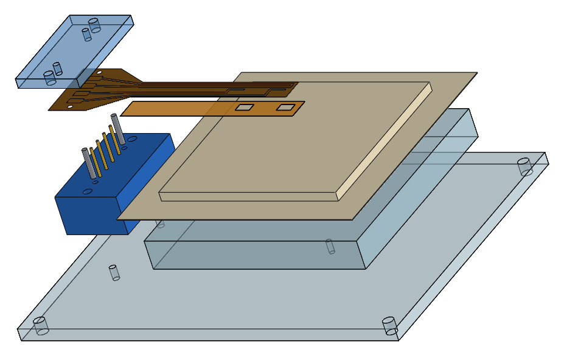
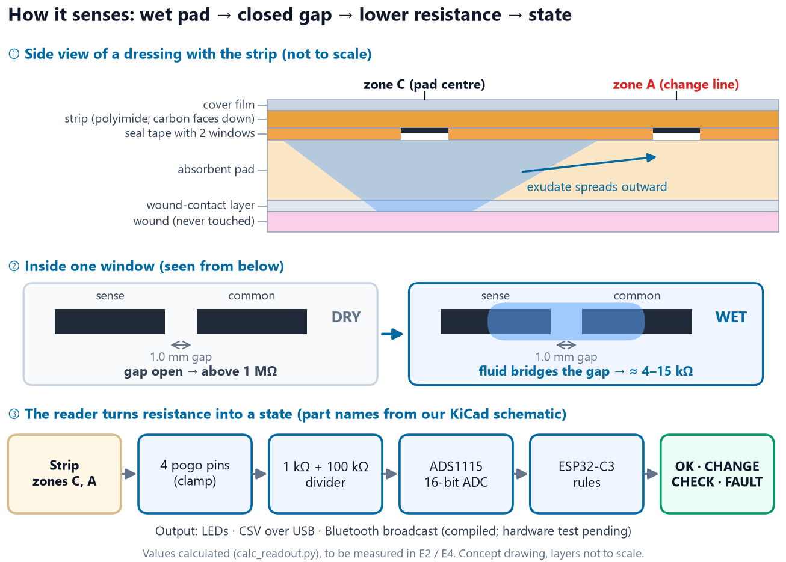
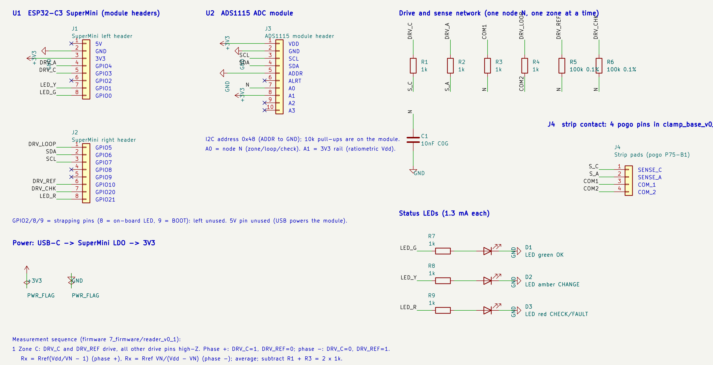
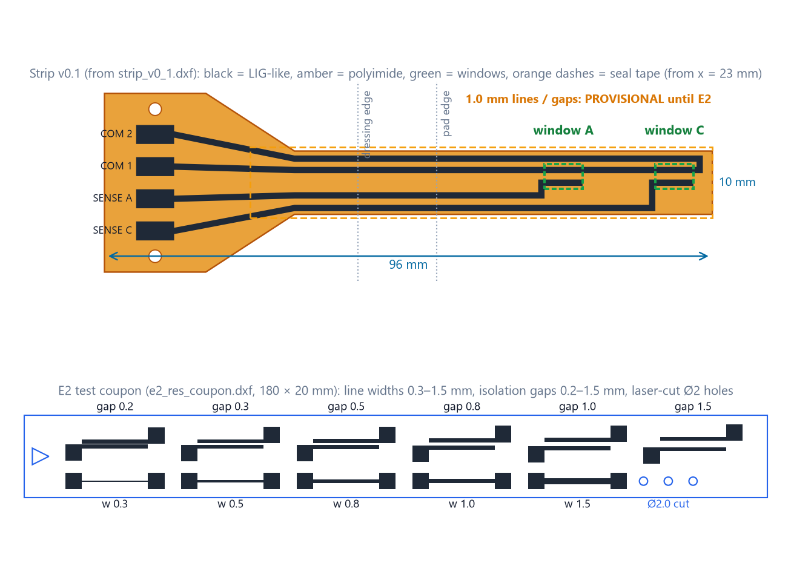
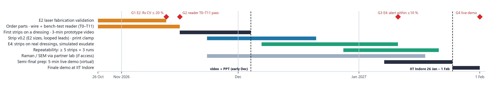

# Dermasense

### Reading a wound dressing's own "change line", without lifting it

**Vishwakarma Awards 2026–27 · Stage 2 (Design Specification) · Health Tech: Emergency Response & Remote Monitoring**
**Application ID VK26-IITI-HT-0050 · Team: Soham Prabhakar Kadu, Bhakti Ajay Kadam · Sanjivani University**



> **Status (20 Oct 2026): design stage.**
> - The strip, clamp, reader circuit and firmware are **designed and checked in software and CAD**.
> - **No physical prototype has been built or tested yet.**
> - Nothing here claims that the sensor works, that the material is graphene, or any clinical benefit.

**Submitted deck:** [`Stage2_Review_Output_2026-10-20/Vishwakarma_Stage2_Refined.pdf`](Stage2_Review_Output_2026-10-20/Vishwakarma_Stage2_Refined.pdf) (19 slides, built on the official template).

---

## 1. The problem, in one sentence

> Nurses and family carers cannot see when a covered wound dressing has actually become full, so they change it by guesswork: too early, which hurts the patient and wastes dressings, or too late, which lets fluid leak onto the skin.

**Who is affected:**

| | Number | Source |
|---|---|---|
| People with a chronic wound in Indian community surveys | **1.9–4.5 per 1,000** | Gupta 2004; Sharma 2024 |
| Indians living with diabetes | **101 million** (11.4 %) | ICMR-INDIAB 2023 |
| Lifetime foot-ulcer risk in diabetes | **19–34 %** (review estimate; upper bound contested) | Armstrong 2017 |
| Patients who say dressing-change pain is the worst part of living with a wound | **40.3 %** of 2,018 | Price 2008 |

**What it costs today:**

| | Number | Source |
|---|---|---|
| Dressing changes made while moisture was still optimal (i.e. possibly too early) | **44.9 %** of 588 | Milne 2016 |
| Time per dressing visit | **≈ 18 min**, about 5 visits a week (UK, patient-reported, industry survey) | Wounds UK 2018 |
| One 10 × 10 cm foam dressing (Indian retail) | **₹240–510** | Truemeds listings |

**Why it happens:**
- Dressing makers already define a "change now" point: exudate about **2 cm** from the pad edge, or "**at 75 %**" on a visual indicator.
- But that sign is **visual**, and the dressing is usually covered by a bandage, sock or clothing.
- The only way to check is to lift it.

## 2. The idea

- A thin **laser-written strip** sits on the outer face of the dressing pad. It never touches the wound.
- It carries two sensing zones:
  - **C** at the pad centre
  - **A** on the dressing maker's own **change line**
- A small **clip-on reader** checks both zones and shows one state:

| State | Meaning | LED |
|---|---|---|
| **OK** | Change line still dry | green |
| **CHANGE** | Fluid has reached the change line (after the centre) | amber |
| **CHECK** | The line is wet *before* the centre: a leak or a misplaced strip | red, blinking |
| **FAULT** | Broken strip or reader error; never shown as OK | red |

**Remote view:** the reader also **broadcasts its state over Bluetooth LE**, so a nurse nearby can see it on a phone without unwrapping anything. It is compiled and tested in software, but **not yet on hardware**, and there is no phone app yet (any BLE scanner app reads it).

## 3. How it works



1. When exudate reaches a zone window, fluid bridges a **1.0 mm gap** between two carbon electrodes.
2. That zone's resistance falls from **above 1 MΩ** (dry) to about **4–15 kΩ** (wet). These are calculated values, to be measured.
3. The reader drives each zone **both ways**, so the wet strip sees no net DC. It reads the result with a 16-bit **ADS1115** ADC.
4. An **ESP32-C3** then decides:
   - wet below 100 kΩ, dry above 300 kΩ
   - the state must hold for 3 scans in a row
   - a known 100 kΩ resistor is checked on every scan

The carbon layer is written by a CO₂ laser on polyimide film. We call it **"laser-carbonised (LIG-like)"** until a Raman test confirms its structure.

## 4. What we have built so far (all digital)

| Area | What exists | Where |
|---|---|---|
| **Sensor strip** | Two-zone strip v0.1 (10 mm wide, 1.0 mm lines/gaps, 4 pads at 5.08 mm), seal-tape layer, design-rule check, laser files | [`4_sensor_strip/`](4_sensor_strip/) |
| **Mechanical (SolidWorks 2019)** | 9 parts, 1 assembly (13 components), 7 A3 drawings, 10 STEP files: contact clamp with 4 pogo pins and 2 dowels, bench rig | [`5_cad/`](5_cad/) |
| **Electronics (KiCad 10)** | Reader schematic: ESP32-C3 SuperMini, ADS1115, 0.1 % reference and check resistors, 3 LEDs; netlist and BOM | [`6_electronics/`](6_electronics/) |
| **Firmware** | Bipolar measurement, hysteresis, OK / CHANGE / CHECK / FAULT, CSV over USB, Bluetooth LE state broadcast | [`7_firmware/`](7_firmware/) |
| **Experiment design** | E2 laser fabrication test: 72 samples and pass rules fixed **before** any data; printable bench sheets; analysis script | [`4_sensor_strip/e2_experiment/`](4_sensor_strip/e2_experiment/) |
| **Decisions and risk** | Requirements R1–R11, decision log D-001…D-015, 5 concepts scored on 13 criteria, design FMEA (15 failure modes) | [`3_decisions/`](3_decisions/) |
| **Research** | 41 sources with reading depth, research-gap analysis, prior-art search, nurse interview guide | [`2_research/`](2_research/) |

<p align="center">
  
  
</p>

## 5. Verification results (re-run 19 Oct 2026)

| Check | Result | What it proves, and what it does not |
|---|---|---|
| CAD verification in SolidWorks (`5_cad/verify_cad.py`) | **99 pass · 0 fail · 5 waiting for E2 data** | Geometry, units, interference, drawings. It found a real clash (seal tape under the clamp), now fixed |
| Laser files (`4_sensor_strip/verify_laser_files.py`) | **35 / 35 pass** | The files are correct, **not** that the strip has been made |
| KiCad electrical rules check | **0 violations** | Schematic rules only |
| Netlist ↔ firmware ↔ strip pads (`7_firmware/tools/check_consistency.py`) | **0 mismatches** | The design files agree with each other |
| Firmware build for ESP32-C3 | **0 warnings**, 650,349 bytes (49 %) | It compiles. It has **never run on a board** |
| Firmware compile-time tests | **23 pass** (a deliberately wrong test breaks the build) | Logic and BLE payload |
| PC-side tests (pytest) | **16 pass** (firmware tools) · **3 pass** (E2 analysis, synthetic data) | Software only |

## 6. Not done yet (stated openly)

- **No laser run yet:** no strip exists, and E2 is ready but not performed.
- **Reader not built or bench-tested**, including Bluetooth (`7_firmware/BENCH_TEST.md`, steps T0–T11).
- **No dressing test** (E4), no user interviews and no clinical use. The bench reader is **not for use on people**.
- **No FEA:** loads are under 3 N, so hand calculations are used instead.
- **Graphene is not confirmed.**

## 7. Roadmap (on the competition's own dates)



| By | Goal | Gate |
|---|---|---|
| mid-Nov 2026 | E2 laser tests; reader wired and bench-tested | Sheet-resistance CV ≤ 20 %; bench test T0–T11 pass |
| early Dec 2026 | First strips on a dressing; 3-minute prototype video | OK → CHANGE on camera, with the raw log |
| Dec – Jan | Strip v0.2, printed clamp, wet tests on real dressings, repeatability | Alert within ±10 % of the visible front |
| Jan 2027 | Virtual semi-final with a live demo | – |

## 8. Repository map

| Folder | Contents |
|---|---|
| [`Stage2_Review_Output_2026-10-20/`](Stage2_Review_Output_2026-10-20/) | **Current deck** (PPTX + PDF), its QA report, change log and evidence map |
| [`1_presentation/`](1_presentation/) | Deck builder, figure scripts, figures, claim → evidence matrix |
| [`2_research/`](2_research/) | Literature, research matrix, research gap |
| [`3_decisions/`](3_decisions/) | Requirements, decision log, sensor selection, FMEA |
| [`4_sensor_strip/`](4_sensor_strip/) | Strip generator, laser files, E2 experiment |
| [`5_cad/`](5_cad/) | SolidWorks native files, drawings, STEP, build and verification scripts |
| [`6_electronics/`](6_electronics/) | Readout calculations, KiCad schematic, BOM |
| [`7_firmware/`](7_firmware/) | ESP32-C3 reader firmware, PC tools, wiring, bench test |
| [`PROJECT_AUDIT.md`](PROJECT_AUDIT.md) | Full audit: what is verified, what is not, who did what |
| [`LAB_NOTEBOOK.md`](LAB_NOTEBOOK.md) | Dated work log |

### Re-run the checks

```bash
python 4_sensor_strip/verify_laser_files.py
```

```bash
python -m pytest -q 7_firmware/tools
```

```bash
python 7_firmware/tools/check_consistency.py
```

```bash
python 5_cad/verify_cad.py --no-sw
```

The full CAD check needs SolidWorks; `--no-sw` runs the file-only checks. The firmware build is:

```bash
arduino-cli compile --fqbn esp32:esp32:esp32c3:CDCOnBoot=cdc 7_firmware/reader_v0_1
```

## 9. How this work was done

- The CAD models, the KiCad schematic, the firmware and most documents are **generated by scripts** written with **AI assistance (Claude)**, under the team's direction. Every commit records this with a `Co-Authored-By` line, and the lab notebook says which entries were AI-drafted.
- The scripts make every model and check re-runnable.
- The **physical build and all tests are done by the team**, starting with experiment E2.
- Prior work before the programme started is not used as evidence.

## 10. Key references

1. Milne S.D. et al., *Int. Wound J.* 13(6):1309–1314 (2016). doi:10.1111/iwj.12521
2. Gupta N. et al., *J. Wound Care* 13(8):323–325 (2004). doi:10.12968/jowc.2004.13.8.26657
3. Sharma A. et al., *Cureus* 16(9):e68684 (2024). doi:10.7759/cureus.68684
4. Anjana R.M. et al. (ICMR-INDIAB-17), *Lancet Diabetes Endocrinol.* 11(7):474–489 (2023)
5. Armstrong D.G., Boulton A.J.M., Bus S.A., *N. Engl. J. Med.* 376:2367–2375 (2017). doi:10.1056/NEJMra1615439
6. Price P.E. et al., *Int. Wound J.* 5(2):159–171 (2008). doi:10.1111/j.1742-481X.2008.00471.x
7. Lin J. et al., *Nat. Commun.* 5:5714 (2014). doi:10.1038/ncomms6714

The full list, with reading depth for every source, is on slide 18 of the deck and in [`2_research/literature.csv`](2_research/literature.csv) and [`Stage2_Review_Output_2026-10-20/new_sources.csv`](Stage2_Review_Output_2026-10-20/new_sources.csv).

## License

**Our own work is released under the [MIT License](LICENSE):** code, CAD, schematics, documents and figures by Team Dermasense.

**Not covered:**
- the **official Vishwakarma Awards template** files (`1_presentation/template/`, `Stage2_Review_Output_2026-10-20/build/template_source/`), which belong to Maker Bhavan Foundation
- the logos inside the decks
- quoted third-party sources

**Disclaimer:** this is a student research prototype. It is **not a medical device** and must not be used on patients.
